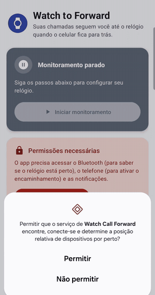
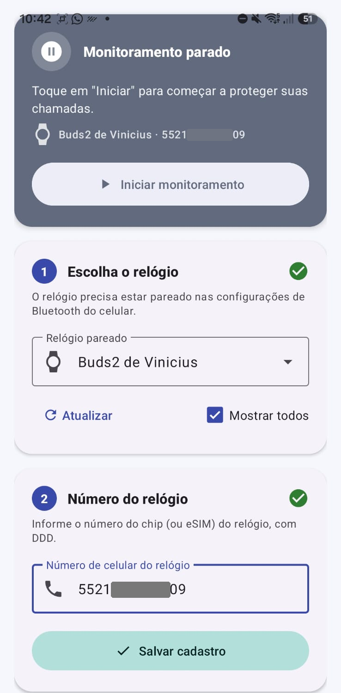
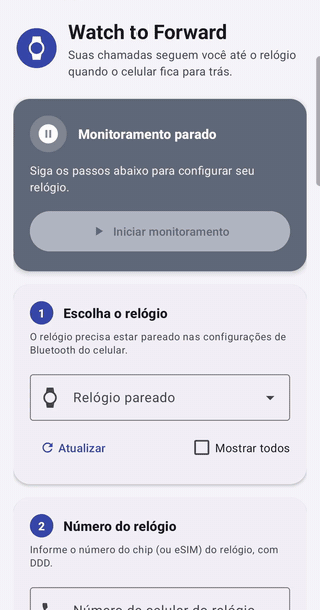
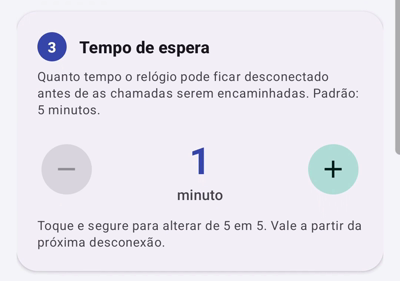
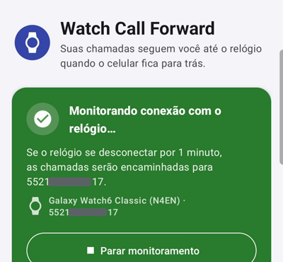
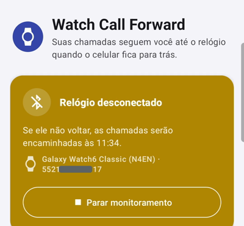
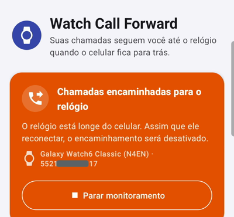
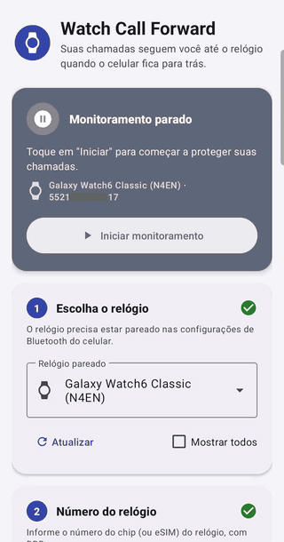

# Como testar sem um smartwatch com rede móvel

O app foi feito para relógios com chip ou eSIM, mas pouca gente tem um. Para testar, **qualquer dispositivo Bluetooth pareado** serve de "relógio": fone de ouvido, caixa de som, rádio do carro, pulseira fitness etc. O app só observa se o dispositivo está conectado ou não.

## O que você precisa

- Celular Android com **chip ativo** (o desvio é feito pela operadora; não funciona em emulador nem sem chip).
- Um dispositivo Bluetooth **já pareado** em *Configurações > Bluetooth*.
- Um número para receber as chamadas desviadas: de um amigo, familiar ou um segundo chip.
  - **Não tem outro número?** Veja [Testando com o próprio número](#testando-com-o-próprio-número).

> ⚠️ Enquanto o desvio estiver ativo, **as chamadas reais** que você receber vão para o número informado. Avise a pessoa dona do número e desative o desvio ao terminar.

## Passo a passo

### 1. Conceda as permissões

Toque em **Conceder permissões** e aceite os pedidos de Bluetooth ("dispositivos por perto"), telefone e notificações.

### 2. Escolha o dispositivo Bluetooth

Por padrão o app lista só smartwatches. Para usar outro dispositivo:

1. Marque **Mostrar todos**.
2. Abra a lista **Relógio pareado** e escolha o dispositivo (no exemplo, um fone Galaxy Buds2).

Se o dispositivo não aparecer, confira se ele está pareado nas configurações do Android e toque em **Atualizar**.

### 3. Informe o número de destino e o tempo de espera

1. Em **Número do relógio**, digite o número que vai receber as chamadas, com DDD (ex.: `5511999999999`).
2. Toque em **Salvar cadastro**.
3. Em **Tempo de espera**, use o botão **−** até chegar a **1 minuto**, para não esperar os 5 minutos padrão.
4. Toque em **Iniciar monitoramento** no topo.

### 4. Teste o ciclo completo

Com o dispositivo **conectado** ao celular, o cartão do topo fica verde:

1. **Desligue o dispositivo** (ou guarde o fone no estojo, ou afaste-se dele). O cartão fica amarelo e mostra o horário em que o desvio será ativado.

   

2. **Aguarde o tempo de espera.** A tela de discagem aparece rapidamente (é normal), o código `*21*NÚMERO#` é enviado e o cartão fica laranja. A operadora costuma confirmar por mensagem na tela ou SMS.

   

3. **Ligue para o seu celular** a partir de um terceiro telefone: a chamada deve tocar no número de destino.
4. **Ligue o dispositivo de novo.** Ao reconectar, o app envia `##21#`, o desvio é desativado e o cartão volta a ficar verde.

O ciclo inteiro, com tempo de espera de 1 minuto:

## Testando com o próprio número

Se você não tiver outro número disponível, informe o **número do próprio celular** como destino. Nos testes feitos, a operadora aceitou ativar o desvio para o mesmo número.

Assim dá para validar todo o fluxo do app: o código é discado, a operadora confirma a ativação e, ao reconectar o dispositivo, o desvio é desativado. A única parte que não dá para conferir é a chamada chegando em outro aparelho.

O comportamento pode variar conforme a operadora; se ela recusar o código, use outro número.

## Problemas comuns

- **Nada acontece depois do tempo de espera:** abra **Últimos eventos** no app para ver o que o app registrou (desconexões, reconexões e ativação do desvio).
- **A operadora recusou o código:** algumas linhas corporativas, pré-pagas ou eSIM bloqueiam o desvio por código. Teste discando `*21*NÚMERO#` manualmente no discador; se também falhar, a limitação é da linha.
- **O desvio ficou ativo:** disque `##21#` no discador para desativar manualmente.
- **O dispositivo não aparece na lista:** marque **Mostrar todos** e toque em **Atualizar**. O app só lista dispositivos já pareados.
- **O app parou de monitorar:** confira se a notificação do app continua na barra e se a otimização de bateria não está encerrando o app.
